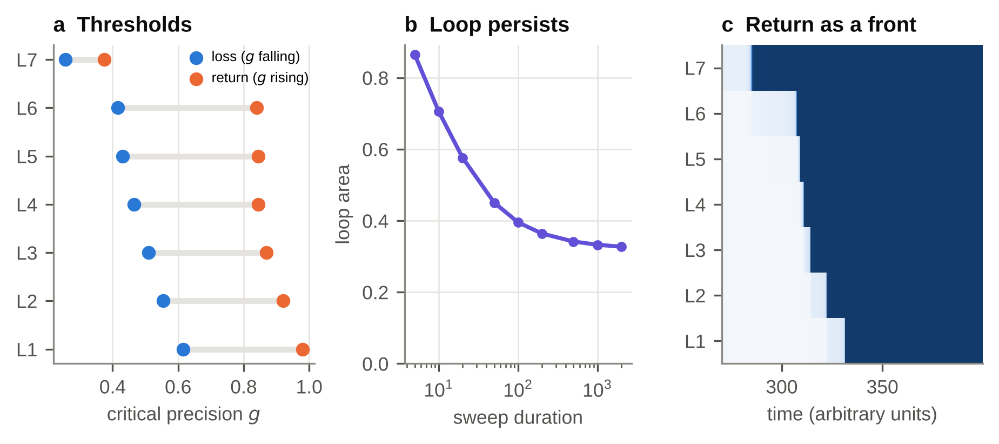

# Results

## Precision determines whether content can be sustained

An isolated level has three regimes set by the single product $gJ$ (Fig. 1b). Below a lower critical point $s(q)=\min_x x^{-1}\ln(p/r)$ only the flat belief exists. With zero net field, above the upper critical point $gJ=q$ the flat belief is unstable and content must arise. Between them the two coexist, separated by a free-energy barrier, with a first-order transition at $2(q-1)(q-2)^{-1}\ln(q-1)$ [24]. Numerical solutions agree with these expressions (Table S2). Beliefs descended $F$ at fixed precision in all 50 random trajectories tested, with «lyap_viol» violations, and heat-bath Monte Carlo of the underlying Potts population ($N=$ «mc_N») reproduced the hysteresis, with jumps at $gJ=$ «mc_down» and «mc_up», inside the mean-field bounds of «mf_lower» and 7 as expected for a finite population (Fig. 1c).

This gives the carrier claim an exact meaning. Before recurrent amplification, the update of a belief by evidence is $\delta u=\frac{q}{q-1}g\,\delta h$, so at $g=0$ no evidence can change a belief, and below $s(q)/J$ no belief can be maintained. Whether a given class of content can exist depends on precision and recurrent self-support together, and not on the content itself. The correspondence is structural: the equation holds by construction of the model, which was built so that precision gates content.

{width=100%}

## Global precision withdrawal produces graded dissolution

On the failing-support path, the hyperprior shape $a(t)$ declines and the mismatch $d^2(t)$ rises. These are the only exogenous changes, apart from the withdrawal of sensory evidence over the first 20% of the path. Levels then collapse one at a time, from L1 to L7 (Fig. 2a, Table 1). No level is assigned a time of collapse.

: **Table 1. Levels, classical correspondences and thresholds.** Classical correspondences follow refs 18–21; "time lost" is on the failing-support path in arbitrary units; thresholds are quasi-static, with the bodily mismatch held at baseline.

«table1»

{width=88%}

The order is controlled by one quantity, the isolated threshold $s(q_i)/J_i$. Across «sw_complete» random parameter sets that completed the path, the rank correlation between the predicted and observed order had a median Kendall $\tau$ of «sw_tau», and the last level to collapse was the predicted one in «sw_last» of sets. The canonical L1-to-L7 sequence is therefore not generic. It appeared in «sw_canon» of unconstrained sets and in «sw_canon_pred» of the «sw_npred» sets whose predicted thresholds were monotonic. Those thresholds are monotonic only if there is a hierarchical gradient and if sensory alphabets are not much smaller than conceptual ones: at baseline, the predicted minimum is $q_s=$ «q0_min» (Table S3). Without a gradient the sequence survives, because collapse spreads along the chain from the edge level, but it is compressed: L1 to L6 fall within «eta0_span» time units, against «base_span» at baseline. The order was unchanged in all 200 noisy trajectories at each noise level up to $\sigma^2=$ «noise_tmax», held in «noise_1» at $\sigma^2=1$, and L7 was last in every trajectory (Table S4).

The traditional numbers allow a small test, which I treat as heuristic because the sources do not describe them as alphabet sizes. The lower critical points for $q=33,40,7$ are «s33», «s40» and «s7». The level with $q=7$ therefore collapses last wherever it is placed among L5–L7. By contrast, the 33 do not precede the 40 on alphabet size alone, since $s(40)>s(33)$: this needs $J_6/J_5>$ «req_ratio», which the hierarchical gradient supplies («J65»). The classification of these classes by "strong, medium and weak" wind [22] corresponds in the model to the precision needed to sustain them, «g5», «g6» and «g7». The direction matches, but the first two are nearly equal.

## Re-emergence is a propagating front, and hysteresis persists

When precision rises, the levels return in the reverse order, starting at L7 at $g=$ «r7» and ending at L1 at $g=$ «r1» (Fig. 3a; L4–L6 are nearly simultaneous). This is not a replay. Loss is governed by $s(q)/J$, which grows slowly with $q$, whereas spontaneous return, with zero net field, is governed by $q/J$, which grows linearly. With inter-level coupling removed, only L7 returned within the range scanned (Table S3). Coupling is what turns the first nucleation into a front: L7 provides a field that erases the barrier of its neighbour, and so on down the chain (Fig. 3c). Reversal thus requires that the last level to go also has the lowest return threshold and that levels are connected. Across random parameters, the first level to return was the one predicted by the lowest $q/J$ in «sw_fb_pred» of the «sw_ramp» sets that completed the scan. Return was monotonic, with ties allowed, in «sw_retmono» of those sets and in «sw_retmono_can» of the «sw_n_both» with a canonical loss sequence; it was strictly monotonic in only «sw_retstrict». Complete return at or below waking precision occurred in «sw_belowwake» of valid sets. Return is less general than loss: in «sw_noreturn» of «sw_valid» sets, the scan did not yield complete loss and return within the range of $g$ tested. All of these were failures of return, and in «sw_failcost» of them the net cost of commitment was positive at the level with the lowest $q/J$, so commitment that costs more than the null component accounts for most failures.

Hysteresis does not disappear with slower sweeps (Fig. 3b): loop area falls from «area_fast» at a sweep duration of 5 to «area_slow» at 2000, with an extrapolated limit of «area_inf». This is a mean-field result. In a finite population, fluctuations will eventually cross the barrier, which is compatible with a stochastic account of neural inertia [31].

{width=100%}

## A closed-form condition for a precision rebound

The precision update has a simple implication. Comparing $g^*$ with and without committed beliefs gives

$$
g^*(W=0)>g^*(W>0)\quad\Longleftrightarrow\quad\rho\equiv\frac{\omega d^2a}{b}>1 .
$$

Here $\rho$ is the normalised residual: the mismatch relative to the variance expected under the hyperprior. When content fits worse than expected, abandoning it raises inferred precision, because a flat belief assigns the mismatch to the null component. When content fits better than expected, abandoning it lowers precision. The criterion does not involve $J$, $\kappa$ or $W$.

On the failing-support path, precision falls as mismatch accumulates, and each collapse brings a small local recovery. The relative size grows along the sequence («local_reb») up to L6, and the largest step is at L6. The last collapse differs in kind, because only it takes $W$ to zero, so that $g$ reaches the flat-state value $a/b$: $g$ moves from «g_min» to «g_max», a rebound of «reb_u» (Fig. 2b). With likelihood weights tilted towards deep levels, as would be expected if visceromotor regions issue interoceptive predictions [32], the rebound is «reb_t» at $\lambda=2$ (Fig. 4a).

The criterion is an algebraic property of the update, so the following are checks of the simulations and not independent confirmations. Across random parameters (Fig. 4b), a rebound above 0.5% occurred in «sw_reb_gt» of the «sw_n_gt» sets with $\rho_c>1$ (in all «sw_n_gt2» with $\rho_c>2$) and in «sw_reb_lt» of the «sw_n_lt» sets with $\rho_c<1$ (Spearman correlation of rebound with $\rho_c$: «sw_spear»). Removing responsibility weighting or replacing inference with a fixed schedule abolished the rebound (Table 2). The new prediction is that a physiologically gentle decline, with $\rho_c<1$, shows no rebound.

Readiness does not rebound with precision at baseline, and this is an important negative result. $R$ falls from «R_entry» on entry into the last stage to a minimum of «R_nadir», spikes as L7 reaches its fold, and peaks at «R_after» just after the collapse, below that minimum, before declining with $a(t)$ towards zero (Fig. 2c). The rise in precision is itself brief: $g$ stays above its post-collapse peak until $t=$ «g_until» of a stage spanning «st6»–«st7», and is back below the pre-collapse trough by $t=$ «g_below». After the collapse the net cost of commitment is positive and every level is clipped at $x=0$, so $R$ measures only a sub-threshold drive and the posterior does not change under small evidence. Counting unclipped levels only, readiness falls from «Rp_min» to 0.

The ordering of those two values of $R$ is not general. With stronger mismatch or tilted weights the post-collapse peak exceeds the pre-collapse minimum (ratio «rr_d16l2» at $D=16$, $\lambda=2$, against «rr_base» at baseline), as it did in «sw_rr_gt1» of «sw_rr_n» random sets. Where every level is clipped, as in «sw_rr_clip» of those sets, this increase is in drive only. What is robust is that a flat posterior does not respond to small evidence while commitment costs more than the null component.

The model therefore reproduces only part of claim 4: a contentless state in which inferred precision has briefly risen above its value immediately before the collapse («g_min» to «g_max»), while remaining below its value for most of the preceding stage. It does not reproduce a recovery of responsiveness on the failing-support path. The stage before the last collapse is also not contentless, since L7 is still committed ($x_7=$ «x7_nadir»). If the classical description of lucidity refers to responsiveness, it would require that the bodily mismatch also ceases to act, a condition I have not modelled.

Table 2 summarises the lesions. Precision inference and responsibility weighting are each necessary for the rebound. Binary beliefs also abolish it, despite $\rho_c=$ «bin_rho»: without a fast jump, $W$ falls too gradually to outrun $a(t)$. The criterion is therefore a necessary condition for a rebound along a path, and is sufficient in practice only at larger residuals. Categorical alphabets are what give first-order transitions: with binary beliefs ($q=2$) there is no discontinuous jump, the small width in Table 2 («w_bin», against «w_full») reflects the scoring thresholds, and return is no longer ordered. At baseline, inter-level coupling is necessary for return at waking precision. Without it, levels other than L7 reach their upper critical point only above $g=$ «qJ_min_sens», where the net cost of commitment is already positive (it turns positive above $g\approx$ «net_zero»). With cheaper commitment ($c=-2$) they do return without coupling, but at $g=$ «k0_lo»–«k0_hi», above the waking value. Removing the hierarchical gradient compresses the sequence without reversing it.

: **Table 2. Lesion analysis.** A lesion is scored against the full model on the failing-support path and on quasi-static sweeps.

«table2»

## Emptiness and readiness are separable

Claim 4 has a second part that does not depend on the sequence: there should be more than one kind of contentless state. Deep-sleep-like, post-collapse and meditative hold states all have commitment near zero and emptiness near one (Fig. 5a, Table 3). Readiness separates them: the hold state is «ratio_hold_sleep» times the deep-sleep-like value and «ratio_hold_dy» times the post-collapse value. This ratio should be read with care. The deep-sleep-like state is defined by an assumed $g=0.2$, and most of the separation is that assumption: the precision ratio is «g_ratio», and the recurrent amplification $R/g$ differs little («amp_sleep» against «amp_hold», rising to «amp_crit» only near instability). Since $R$ contains $g$ by definition, this separation is not a finding about precision. The result is one of form: readiness in flat states is not determined by activity, so contentless states at similar commitment can differ in it, through precision or through recurrent amplification ($R$ rises from «R_hold» to «R_crit» at identical $g$ as $J_s$ goes from 0.20 to 0.28). The integration proxy differs roughly «si_ratio»-fold between hold and deep-sleep-like states, with commitment near zero in both, although both absolute values are small (Table 3).

: **Table 3. Reference states.** $A$, commitment; $\varepsilon$, emptiness; $R$, readiness; SI, stochastic interaction at the minimum-information bipartition. Evoked responses are the area under the summed $|\delta u_i|$ after a pulse to L7, with the number of levels reached in parentheses. Band power is that of $\delta u$, relative to the hold state. Waking and dreaming-like states differ only in sensory evidence and are numerically almost identical. In the two failing-support states, $R$ includes sub-threshold drive at clipped levels. At their saturated commitment SI is not informative and is not reported; levels clipped at $x=0$ are decoupled, so SI is zero in the two failing-support states.

«table3»

Simulated pulses show that the kind of perturbation matters (Fig. 5b,c). An evidence pulse is scaled by precision by construction, so it inherits the separation: after a pulse to L7 the response at hold was «pt_hold_sleep» times the deep-sleep-like response. A direct pulse, the closer analogue of magnetic stimulation if stimulation bypasses gain, gives ratios of «ptd_hold_sleep» at L7 and «ptd4_hold_sleep» at L4. The sizes of these ratios depend on the pulse (evidence «amp_ev_lo»–«amp_ev_hi», direct «amp_d_lo»–«amp_d_hi» across the amplitudes tried); only their ordering is stable. Under direct stimulation, the states differ more in the response outside the stimulated level («ptd_ns_hold» at hold against «ptd_ns_sleep» in the deep-sleep-like state, after a pulse to L7). This direction depends on the assumed deep-sleep precision: with that state still flat, the total ratio falls below 1 above $g\approx$ «sg_tot» and the ratio outside the stimulated level above $g\approx$ «sg_ns».

On the failing-support path, the response to an evidence pulse fell from the last stage («pt_nadir») to the post-collapse state («pt_dycl»). A direct pulse does the opposite («ptd_last» to «ptd_dycl», above the deep-sleep-like «ptd_sleep»), because L7 is no longer saturated and its self-support, $gJ_7=$ «gj7_dy», exceeds $s(7)=$ «s7». Both measures are in $\delta u$ and so include sub-threshold drive. In commitment, the response to an evidence pulse was «ptx_dycl» after the collapse, against «ptx_sleep» in the deep-sleep-like state and «ptx_hold» at hold, which shows directly how little the flat posterior responds there. That state is not absorbing: with $g$ clamped, a direct pulse of «rei_kick» nat or more re-ignited L7, whereas the hold state did not ignite even at 6 nat. Near instability the response grows over the 2.5 s window instead of decaying, so its area in Table 3 is limited by the window.

On the prior-relaxation path, $J_s$ falls, levels collapse and precision goes to the flat-state value $a/b$. Whether precision rises or falls on the way depends on the baseline residual $\rho_0$: it rose from «g_med0» to «g_medh» at $\rho_0=1.5$ and fell when $\rho_0<1$, crossing over at $\rho_0\approx1$ as the criterion requires (Table S5). A rise in precision during meditation is therefore not a general prediction. What is general, under assumption A1, is that the flat-state precision is set by $a/b$ alone, independent of mismatch, so that an intact substrate permits a contentless state with high precision. This is the model's version of the distinction drawn in the tradition between the clear light of dying and that attained in meditation [18].

## Metastability implies a trade-off between readiness and stability

The phase diagram (Fig. 6a) has a region in which flat and contentful solutions coexist at the same $(g,J_s)$, so that whether content is present depends on the path taken. Dreaming-like states, which retain content without sensory evidence at substantial precision, lie on the contentful branch, and states with a flat belief at substantial precision lie on the other. The Kālacakra tantra assigns waking, dreaming, deep sleep and a fourth state to distinct bodily centres [23]. Here waking and dreaming-like states differ only in sensory evidence, so the correspondence is coarse. I do not equate the fourth state with the flat, high-precision regime, because that source defines it by a transient peak of bliss. At zero net evidence, the flat state of L7 is stable if and only if

$$
gJ_s<\frac{q_7}{J_7}\approx «gjs»,
$$

so that halving the precision of priors doubles the precision the flat state can bear. With the net evidence at baseline the limit is lower, $J_s\approx$ «js_limit» at $g=1.2$.

Within this region, moving towards instability raises readiness and lowers the barrier (Fig. 6b,c; Table S6). Noisy escape times follow accordingly: mean first-passage time fell from «dw_a» at $J_s=$ «dw_ja» to «dw_b» at $J_s=$ «dw_jb», and at values of $J_s$ with no censored trials the distributions were roughly exponential and slightly under-dispersed («dw_note»). At $J_s=0.23$, 50 of 300 trials were censored and the fit was poorer (Table S7). The trade-off has the same form as the two classical faults of meditative concentration, laxity (*laya*), in which clarity is deficient, and excitation (*auddhatya*), in which thoughts arise unbidden. This is an analogy only, since the trade-off is generic to a fold.

{width=100%}

## Imposed routes

When priors are relaxed level by level, the order of loss follows the imposed signal, except that L6 falls marginally before L7 (Fig. 7a). This does not explain reports of thoughts ceasing before percepts [3], since the order is put in by hand. It shows only that, in this model, the sequence is not fixed once level-specific control is allowed. The model does not reproduce the further report that simple bodily sensations disappear last [3]: under top-down relaxation L4, which carries the body, is lost before L1. I treat this as unresolved. The anaesthesia finding of preferential disruption of frontal–parietal feedback [33] is also unresolved: the symmetric coupling $\kappa$ cannot represent a loss specific to feedback.

{width=88%}

Table 4 compares the model with published findings. The comparison is directional only, since no parameter was fitted to data.

: **Table 4. Comparison with published findings.**

| Finding | Model | Assessment |
|:---------|:---------|:----|
| Gamma power falls widely in pure presence, in Vajrayāna and Zen practitioners and in a no-report paradigm [3] | Commitment $A$ is lowest in the flat states | Consistent |
| Delta power in pure presence is much lower than in dreamless sleep, and as low as or lower than in mind-wandering, movie imagining and movie watching [3] | Delta-band fluctuations differ little across flat states (Table 3); sleep slow waves are absent from the model | Compatible with pure presence; deep sleep not captured |
| Intralaminar and medial thalamic nuclei lead prefrontal cortex during conscious perception (5 patients) [34] | Compatible with a thalamic source for gain; not modelled | Compatible |
| Return of responsiveness after anaesthesia is associated with brainstem, thalamic and anterior cingulate activation rather than neocortex, in a PET state contrast [9] | Return begins at L7 and propagates outward | Compatible, on a core–periphery reading of the hierarchy; timing was not measured |
| Hysteresis beyond pharmacokinetics; induction and emergence are not mirror images [7,8] | Non-zero loop in the slow limit; thresholds differ between directions | Consistent |
| Most of 5 unresponsive dying patients retain a mismatch negativity, and some a P3a or P3b; the authors suggest hearing may be among the last senses to go, though other senses were not tested [35] | Auditory level is the second to collapse on the canonical route | **Conflict**, if the responses reflect hearing |
| In Zen Shikantaza, thoughts decrease while percepts are preserved (8 practitioners), and meditators report that simple bodily sensations are last to disappear [3] | Global route at baseline is sensory-first; a thought-first order was obtained only by imposing it; body is not last | **Conflict**, unresolved |
| Anaesthesia preferentially disrupts frontal–parietal feedback [33] | Symmetric coupling cannot represent this; on a sensory-to-prefrontal reading it opposes the canonical route | **Conflict**, unresolved; a core–periphery reading is a hypothesis |
| Alpha power declines over about 40 s before meditative cessation (one practitioner, 37 events) [36] | A slow fall in $g$ is compatible; alpha is not modelled | Compatible |
| Gamma surge in the posterior hot zone in 2 of 4 dying patients, those with a rise in heart rate [37] | The criterion selects high-mismatch cases, but in this model gamma indexes commitment, not the flat state | Undetermined |
| No recognisable EEG responses in 7 analysed cases of putative *thugs dam* (13 enrolled), recorded 26 h or more after death [38] | All observables vanish as $a\to0$ | Outside the model's scope |
